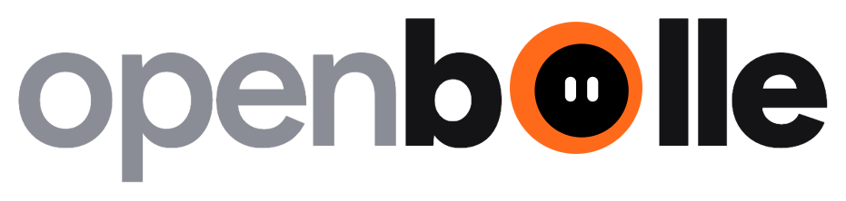
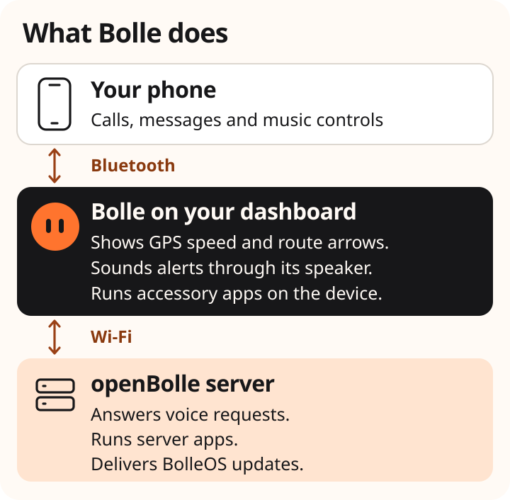

<picture>
  <source media="(prefers-color-scheme: dark)" srcset="design/openbolle_logo_donker.png">
  
</picture>

# A small companion for your dashboard

Bolle started with a simple idea. Could a round screen give you directions, show your speed and answer a question while your phone stays in your pocket? Its face has two eyes. Its printed case holds the screen, GPS, speaker and battery.

## What Bolle does

## Build your own

Start with the [build guide](https://openbolle.nl/docs/bolle). It lists the parts and explains how to put them together. The case print files and the full parts list, including the screws, are in [models/case/v1/](models/case/v1/), which also explains how to print them. The same files are attached to each [release](https://github.com/jolynstudios/openbolle/releases). Then connect Bolle by USB and open the [installer](https://openbolle.nl/installeren). The site and device menus are in Dutch.

For the car, print a mount from [models/mounts/](models/mounts/), sorted by car brand. There is one for the [Tesla Model 3 and Model Y dashboard](models/mounts/tesla/model-3-y-dashboard/).

## Explore the project

The [design folder](design/) holds the artwork. For setup, operation and the software behind Bolle, visit [openbolle.nl](https://openbolle.nl/). To build an app, follow the [development guide](https://openbolle.nl/docs/ontwikkelen/) or open the [English tools and examples](https://github.com/jolynstudios/openbolle-apps).

The case and the mounts in [models/](models/) use CC BY-SA 4.0. BolleOS is distributed as a signed download for use on your own device. Its source is private. Apps and the SDK have their own licences.
