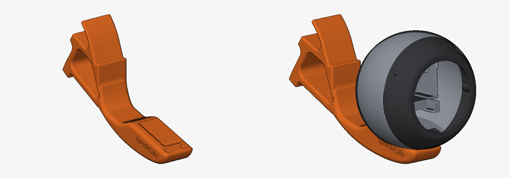

# Dashboard mount: Tesla Model 3 and Model Y

A clip-on mount for Bolle (case v1). It clamps onto the dashboard of the Tesla Model 3 and Model Y. Bolle slides onto the mount's dovetail tongue from the front and clicks into place.

## Files

| file | what |
|---|---|
| `openbolle-mount-click-test.3mf` / `.stl` | **print this first:** three short test tongues with different click strength (7 cm³) |
| `openbolle-mount-tesla-model-3-y.3mf` / `.stl` | the mount, laid out for printing on a 256 × 256 mm plate (43 cm³) |

## 1. Print the click test

The tongue is solid, so the click depends on how far its two small nubs stick out. The test print has three short tongues marked **0,15**, **0,25** and **0,35** (mm). Slide each one into the slot under Bolle's rear shell. The right one clicks clearly, slides with one hand and does not come loose on its own.

The mount files use **0,35**. If a lower number feels better, change `KLIK_OVER` in the source and rebuild, or ask on [openbolle.nl](https://openbolle.nl).

## 2. Print the mount

- PLA or PETG, 0.2 mm layers, 4 walls, 30 % infill. No supports.
- Keep the supplied orientation: flat on its side, logo facing up. The clamp then flexes along the layers, so it does not split along a layer line.
- Add a 3–5 mm brim only if your printer tends to lift long parts.

## 3. Use

1. Clip the mount onto the edge of the dashboard.
2. Place Bolle on the mount, about 3 cm in front of its end position, with its back towards the clamp. Push it back until it clicks.
3. Plug the USB-C cable into the back. A straight plug up to 30 mm long fits; an angled plug is easiest.
4. To take Bolle off, pull it forwards.

**Too little grip on the dashboard?** Make only the clamp wider (`B_KLEM` 28–30 mm instead of 24). Keep the part under Bolle at 24 mm.

## Fit

The tongue was checked against the case v1 model: 0.18 mm clearance on the sides, 0.20 mm on top and at the stop, and 0.10 mm under Bolle. Nothing overlaps.

Design © 2026 openBolle · [openbolle.nl](https://openbolle.nl) · CC BY-SA 4.0 ([licence](../../case/LICENSE))
